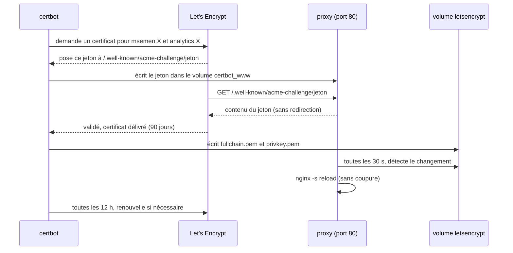
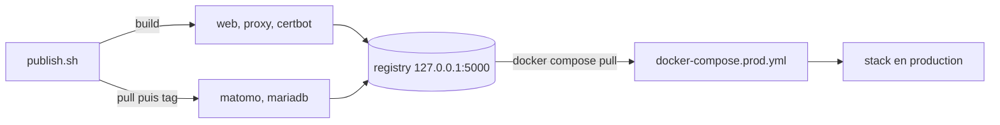

# MSEMEN 🇲🇦

Site vitrine sur le msemen marocain, déployé avec **Docker Compose** : reverse proxy Nginx, **HTTPS Let's Encrypt**, statistiques **Matomo** sur une base **MariaDB**, images publiées dans un **registry privé**. Projet YNOV, Conteneurisation et Orchestration.


## Les services

| Service | Image | Rôle |
|---|---|---|
| `proxy` | **la nôtre** (nginx) | seule porte d'entrée, ports 80 et 443, route par nom de domaine |
| `web` | **la nôtre**, build multi-stage | site statique (HTML, CSS, JS, photos) |
| `certbot` | **la nôtre** (basée sur certbot) | obtient et renouvelle le certificat Let's Encrypt |
| `matomo` | officielle `matomo`, republiée dans le registry | statistiques de visites |
| `db` | officielle `mariadb`, republiée dans le registry | base de données de Matomo |
| `registry` | officielle `registry:2` | registry privé, accessible uniquement depuis la VM |

Le site vit sur `msemen.<domaine>` et Matomo sur `analytics.<domaine>`. Le proxy choisit la destination d'après le nom demandé : `analytics.*` va vers Matomo, tout le reste vers `web`.

## Lancer en local (développement)

```bash
mkdir -p secrets
tr -dc A-Za-z0-9 </dev/urandom | head -c 32 > secrets/db_password.txt
tr -dc A-Za-z0-9 </dev/urandom | head -c 32 > secrets/db_root_password.txt
docker compose up -d --build
```

- Site : http://msemen.localhost
- Matomo : http://analytics.localhost

En local tout est en HTTP : le proxy ne redirige pas les noms en `*.localhost`, et `certbot` n'est pas lancé.

## Déployer sur une VM avec Ansible

Le playbook `ansible/deploy.yml` s'exécute **sur la VM elle-même**. Il installe Docker, clone le dépôt, génère les mots de passe, démarre le registry privé, construit et publie les images, puis lance la stack de production depuis le registry.

### 1. Préparer le nom de domaine (une seule fois)

1. Créer un compte sur [duckdns.org](https://www.duckdns.org) et un sous-domaine, par exemple `monnom`. Le domaine est alors `monnom.duckdns.org`.
2. Noter le **token** affiché en haut de la page (c'est un secret, ne pas le committer).

DuckDNS fait aussi pointer `msemen.monnom.duckdns.org` et `analytics.monnom.duckdns.org` vers la même adresse IP. Le playbook met l'adresse à jour tout seul quand on lui donne le token.

### 2. Lancer le déploiement

Sur la VM, en root, récupérer le dépôt :

```bash
apt-get update && apt-get install -y git ansible
git clone https://github.com/Wassim-Moumine/msemen-ui.git /opt/msemen-ui || git -C /opt/msemen-ui pull --ff-only
```

Puis écrire les variables dans un fichier réservé à root (le token n'apparaît ainsi ni dans l'historique du shell, ni dans la liste des processus) :

```bash
cat > /root/msemen-vars.yml <<'EOF'
domain: monnom.duckdns.org
certbot_email: prenom.nom@exemple.fr
duckdns_token: LE_TOKEN
tls_staging: true
EOF
chmod 600 /root/msemen-vars.yml
```

Et lancer :

```bash
ansible-playbook /opt/msemen-ui/ansible/deploy.yml -e @/root/msemen-vars.yml
```

`tls_staging: true` demande un certificat de **test** à Let's Encrypt : le navigateur l'affichera comme non fiable, mais cela valide toute la chaîne sans consommer les quotas. Une fois que ça passe, passer au vrai certificat (voir plus bas).

Le playbook affiche à la fin les deux adresses et dit si le certificat a été obtenu.

### 3. Configurer Matomo (une seule fois)

Ouvrir `https://analytics.monnom.duckdns.org`. La connexion à la base est préremplie (le champ mot de passe affiche `**********`, c'est un masque). Créer le compte administrateur, puis ajouter le site avec l'URL `https://msemen.monnom.duckdns.org`. Ce doit être le site numéro 1, car `site/js/analytics.js` envoie les visites vers `idsite=1`.

### Variables du playbook de déploiement

| Variable | Défaut | Rôle |
|---|---|---|
| `domain` | **obligatoire** | domaine de base, par exemple `monnom.duckdns.org` |
| `certbot_email` | vide | e-mail de contact Let's Encrypt (sinon inscription sans e-mail) |
| `tls_staging` | `false` | `true` : certificat de test |
| `duckdns_token` | vide | si renseigné, met à jour l'IP du domaine DuckDNS |
| `dns_check` | `true` | attend que les deux noms pointent vers la VM avant de lancer certbot |
| `registry` | `localhost:5000` | autre valeur : registry externe (faire `docker login` avant) |
| `image_tag` | `1.0` | version des images |
| `repo_version` | `main` | branche ou tag à déployer |
| `swap_size` | `2G` | taille du swap créé sur les petites VMs (moins de 1,5 Go de RAM) |

Le playbook peut être relancé autant de fois que nécessaire : il ne refait que ce qui a changé.

### Passer au vrai certificat

```bash
ansible-playbook /opt/msemen-ui/ansible/destroy.yml -e remove_certs=true -e confirm=yes
sed -i 's/^tls_staging: true/tls_staging: false/' /root/msemen-vars.yml
ansible-playbook /opt/msemen-ui/ansible/deploy.yml -e @/root/msemen-vars.yml
```

### Le lendemain (VMs éteintes le soir)

- Si la VM a seulement été éteinte puis rallumée, les conteneurs redémarrent seuls (`restart: unless-stopped`) et les volumes sont conservés. Rien à faire.
- Si la VM a été recréée, ou si son adresse IP a changé : refaire les étapes « Récupérer le dépôt » et « Écrire le fichier de variables », puis relancer `deploy.yml`. Le domaine est repointé vers la nouvelle IP, tout est reconstruit, et il faut refaire l'assistant Matomo. Si le fichier `/root/msemen-vars.yml` existe encore, la dernière commande suffit.
- Let's Encrypt limite le nombre de certificats délivrés pour un même nom (5 par semaine). En cas de redéploiements très fréquents, utiliser `tls_staging=true`.

## Détruire ou nettoyer avec Ansible

`ansible/destroy.yml` arrête toujours la stack. Les autres options sont à activer une à une :

| Option | Effet |
|---|---|
| *(aucune)* | arrête et supprime les conteneurs, **garde** tous les volumes et fichiers |
| `remove_data=true` | supprime les volumes de la base et de Matomo |
| `remove_certs=true` | supprime les volumes du certificat HTTPS |
| `remove_registry=true` | supprime le registry privé et ses images |
| `remove_images=true` | supprime les images locales du projet |
| `remove_files=true` | supprime `/opt/msemen-ui` et les mots de passe générés (exige `remove_data=true`) |
| `purge=true` | active toutes les options ci-dessus |

Toute option destructive demande `-e confirm=yes`. Exemples :

```bash
ansible-playbook /opt/msemen-ui/ansible/destroy.yml
ansible-playbook /opt/msemen-ui/ansible/destroy.yml -e purge=true -e confirm=yes
```

## Comment fonctionne le HTTPS



- Tant que le vrai certificat n'existe pas, le proxy utilise un certificat provisoire intégré à l'image, ce qui lui permet de démarrer et de répondre au défi.
- Le port 80 redirige vers HTTPS (code 301), sauf pour `/.well-known/acme-challenge/` et pour les noms en `*.localhost`.
- Le certificat est unique : il couvre `msemen.<domaine>` et `analytics.<domaine>`.

## Registry privé et publication



`publish.sh` construit les images du projet, reprend celles de Matomo et MariaDB sur Docker Hub, les renomme avec l'adresse du registry et les pousse toutes. `docker-compose.prod.yml` ne construit rien : il tire les images du registry. L'adresse et la version viennent des variables `REGISTRY` et `TAG` (défauts : `localhost:5000` et `1.0`), que le playbook écrit dans `/opt/msemen-ui/.env`.

Le registry n'écoute que sur `127.0.0.1` et demande un mot de passe : il n'est pas joignable depuis Internet. Pour y pousser depuis son PC, passer par un tunnel SSH.

## Notions mises en œuvre

- **Build multi-stage** : l'image `web` télécharge les librairies JavaScript dans une première étape (`alpine` avec `curl`), puis une seconde étape (`nginx`) ne garde que le résultat. L'image `proxy` génère de la même façon son certificat provisoire.
- **Volumes** : `db_data` et `matomo_data` gardent les données, `letsencrypt` garde le certificat (pour ne pas en redemander un à chaque redémarrage), `certbot_www` est partagé entre certbot et le proxy pour le défi.
- **Docker secrets** : les mots de passe de la base sont des fichiers dans `secrets/`, montés sous `/run/secrets/` et lus via les variables `*_FILE`. Ils n'apparaissent pas dans `docker inspect`.
- **Healthchecks et `depends_on`** : Matomo attend que la base soit prête, le proxy a son propre point de santé.
- **Reverse proxy** : un seul point d'entrée, résolution des noms par le DNS interne de Docker, en-têtes `X-Forwarded-*`.

## Points d'attention

- **Mémoire** : la VM n'a que 458 Mo de RAM. Le playbook ajoute 2 Go de swap. Si Matomo devient lent, passer la VM à 1 Go.
- **Mot de passe dans Matomo** : l'assistant de Matomo recopie le mot de passe de la base dans `config.ini.php`, dans le volume `matomo_data`. Les Docker secrets protègent donc le conteneur de la base, pas ce fichier.
- **Matomo derrière HTTPS** : en production, `matomo/common.config.ini.php` est monté dans Matomo pour lui indiquer qu'il est servi en HTTPS et pour qu'il lise l'adresse réelle des visiteurs dans `X-Forwarded-For`.
- **Le proxy tourne en root** (image Nginx officielle) car il doit lire les clés TLS.
- **Port 443** : à ouvrir aussi dans le pare-feu du fournisseur de la VM s'il y en a un.

## Structure du dépôt

```
.
├── ansible/            deploy.yml, destroy.yml
├── certbot/            image certbot + script de renouvellement
├── docs/               schéma d'architecture
├── matomo/             configuration Matomo pour la production
├── proxy/              image du reverse proxy (nginx.conf, certs.sh)
├── registry/           registry privé (compose)
├── site/               le site : HTML, CSS, JS, photos
├── Dockerfile          image web (multi-stage)
├── nginx.conf          configuration du conteneur web
├── docker-compose.yml        développement (construit les images)
├── docker-compose.prod.yml   production (tire les images du registry)
└── publish.sh          construit et publie les images
```

Photos : Wikimedia Commons, sous licences libres. Les crédits sont en bas de la page du site.
