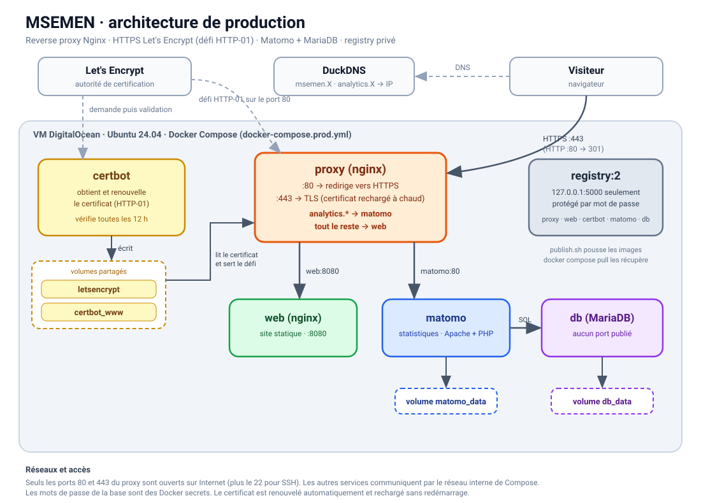

# MSEMEN 🇲🇦

Site vitrine sur le msemen marocain, déployé avec Docker Compose : reverse proxy Nginx, HTTPS Let's Encrypt, statistiques Matomo sur MariaDB, images publiées dans un registry privé. Projet YNOV, Conteneurisation et Orchestration.



## Les services

| Service | Image | Rôle |
|---|---|---|
| `proxy` | Nginx officiel | seule porte d'entrée (ports 80 et 443) |
| `web` | **la nôtre** (multi-stage) | le site statique |
| `matomo` | Matomo officiel | statistiques de visites |
| `db` | MariaDB officiel | base de données de Matomo |

Le site est sur `msemen.<domaine>` et Matomo sur `analytics.<domaine>`.

## En local

```bash
mkdir -p secrets
tr -dc A-Za-z0-9 </dev/urandom | head -c 32 > secrets/db_password.txt
tr -dc A-Za-z0-9 </dev/urandom | head -c 32 > secrets/db_root_password.txt
docker compose up -d --build
```

Site : http://msemen.localhost, Matomo : http://analytics.localhost (en HTTP).

## Sur la VM

**Une fois** : sur duckdns.org, créer un sous-domaine (par exemple `monnom`), y mettre l'IP de la VM et noter le token.

Sur la VM, en root :

```bash
apt-get update && apt-get install -y git ansible
git clone https://github.com/Wassim-Moumine/msemen-ui.git /opt/msemen-ui || git -C /opt/msemen-ui pull --ff-only
```

```bash
cat > /root/msemen-vars.yml <<'EOF'
domain: monnom.duckdns.org
certbot_email: prenom.nom@exemple.fr
duckdns_token: LE_TOKEN
tls_staging: true
EOF
chmod 600 /root/msemen-vars.yml
```

```bash
ansible-playbook /opt/msemen-ui/ansible/deploy.yml -e @/root/msemen-vars.yml
```

`tls_staging: true` donne un certificat de test (le navigateur le jugera non fiable). Pour le vrai certificat, voir plus bas.

Puis ouvrir `https://analytics.monnom.duckdns.org` et faire l'assistant de Matomo (une fois) : créer le compte, ajouter le site `https://msemen.monnom.duckdns.org`.

## Détruire et rejouer

```bash
ansible-playbook /opt/msemen-ui/ansible/destroy.yml
```

Par défaut, cela arrête seulement les conteneurs. Options (toutes avec `-e confirm=yes`) :

| Option | Effet |
|---|---|
| `remove_data=true` | supprime aussi les données (base et Matomo) |
| `remove_certs=true` | supprime le certificat HTTPS |
| `purge=true` | supprime tout, pour repartir de zéro |

**Vrai certificat** : `destroy.yml -e remove_certs=true -e confirm=yes`, puis passer `tls_staging` à `false` dans `/root/msemen-vars.yml` et relancer `deploy.yml`.

**Repartir de zéro** : `destroy.yml -e purge=true -e confirm=yes`, puis refaire le clone et `deploy.yml`.

## À savoir

- **HTTPS** : certbot est installé sur la VM. Il prouve à Let's Encrypt que la VM contrôle le domaine (défi HTTP-01 sur le port 80), puis écrit le certificat dans `/etc/letsencrypt`, que le proxy lit. Le renouvellement est automatique.
- **Registry** : `publish.sh` construit l'image `web` et reprend les images officielles, puis les pousse dans un registry qui n'écoute que sur `127.0.0.1` de la VM, donc privé. `docker-compose.prod.yml` ne construit rien : il tire ces images.
- **Mémoire** : la VM n'a que 458 Mo de RAM, le playbook ajoute 2 Go de swap.
- **Proxy** : si `web` ou `matomo` est recréé seul, relancer le proxy (`docker compose -f docker-compose.prod.yml restart proxy`).
- **Port 443** : à ouvrir dans le pare-feu du fournisseur s'il y en a un.

## Ce que ça illustre

- Build multi-stage (image `web`)
- Volumes (`db_data`, `matomo_data`)
- Docker secrets (mots de passe de la base)
- Healthcheck et `depends_on`
- Reverse proxy et DNS interne de Docker
- Bind mount et variables d'environnement (config du proxy)
- Registry privé et compose de production
- Ansible (déploiement et destruction)

## Structure

```
ansible/     deploy.yml, destroy.yml
docs/        schéma d'architecture
matomo/      config de Matomo pour la production
proxy/       config Nginx (dev et prod)
registry/    registry privé
site/        le site
Dockerfile, nginx.conf   image web
docker-compose.yml       développement
docker-compose.prod.yml  production
publish.sh               construit et publie les images
```

Photos : Wikimedia Commons, licences libres (crédits en bas du site).
